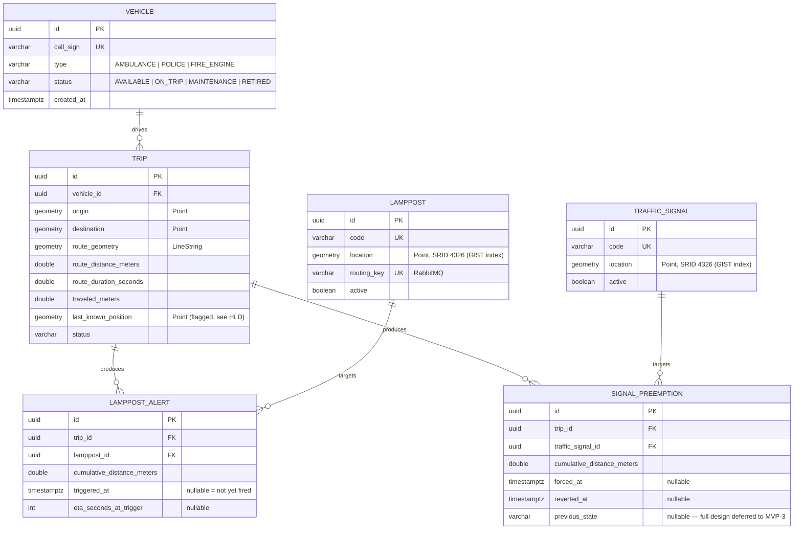

# LLD: MVP-0 Data Model

**HLD version this was written against:** 1.0.0 (`docs/mvp-0/HLD.md`)
**Status:** `Vehicle`, `Lamppost`, `TrafficSignal` implemented — migration
`V1` applied and validated against the entity classes (Hibernate
`ddl-auto=validate` passes clean). `LamppostAlert`/`SignalPreemption` remain
design-only until `Trip` exists (MVP-1/MVP-3).

**Interactive schema reference**: [EVAS Schema Explorer](https://claude.ai/code/artifact/75cdb05e-04c4-4ca5-9b4e-b76d3b1cd5ef)
— click-through ER diagram covering all six tables (private Claude artifact,
Arpith's account only).

All entities and DB-level design for MVP-0 in one place, rather than split
across a file per entity.

## ER Diagram

Full designed model. Only `vehicle`, `lamppost`, `traffic_signal` are
created in MVP-0 (`V1__create_vehicle_and_device_tables.sql`); `trip`,
`lamppost_alert`, `signal_preemption` are shown for context and land in
MVP-1/MVP-3 — they need a `trip` table to reference.

## Vehicle

| Field | Type | Notes |
|---|---|---|
| `id` | UUID | primary key, generated |
| `callSign` | String | required, unique — e.g. "KA-01-AB-1234" |
| `type` | enum: `AMBULANCE`, `POLICE`, `FIRE_ENGINE` | required |
| `status` | enum: `AVAILABLE`, `ON_TRIP`, `MAINTENANCE`, `RETIRED` | required, default `AVAILABLE` |
| `createdAt` | Instant | required, set on creation |

`status` replaced an earlier boolean `active` design — chosen so future
vehicle-state tracking (e.g. maintenance workflows) has room to grow without
a breaking schema change. A trip can only be created for an `AVAILABLE`
vehicle (enforced in the Trip component, MVP-1 — not here).

**REST**: `POST /api/vehicles`, `GET /api/vehicles` (filter by `type`,
`status`), `GET /api/vehicles/{id}`, `PATCH /api/vehicles/{id}`. No
`DELETE` — `status=RETIRED` is the "remove" mechanism, so history/foreign
keys from later `Trip` records stay valid.

## Lamppost

| Field | Type | Notes |
|---|---|---|
| `id` | UUID | primary key, generated |
| `code` | String | required, unique — e.g. "LP-MG-ROAD-014" |
| `location` | Point (SRID 4326) | required. JTS/PostGIS coordinate order is `(lng, lat)`. |
| `routingKey` | String | required, unique — RabbitMQ routing key this device's alert instructions publish under (e.g. `lamppost.LP-MG-ROAD-014`) |
| `active` | boolean | default `true` |

**Geometry over REST**: plain `{"lat": ..., "lng": ...}`, not GeoJSON —
simplest since this project owns both ends of the API. Converted to/from a
JTS `Point` in a service/converter layer.

**REST**: `POST /api/lampposts`, `GET /api/lampposts` (filter by `active`),
`GET /api/lampposts/{id}`, `PATCH /api/lampposts/{id}`. No `DELETE`, same
reasoning as `Vehicle`.

## LamppostAlert

Kept as a minimal DB row rather than fully stateless — gives a real audit
trail now, ahead of a possible future migration to a dedicated logging
service (see `/FUTURE_UPGRADES.md`). No revert/expiry semantics like
`SignalPreemption` will get later — this is fire-once, not stateful in that
sense.

| Field | Type | Notes |
|---|---|---|
| `id` | UUID | primary key, generated |
| `trip` | FK → Trip | |
| `lamppost` | FK → Lamppost | |
| `cumulativeDistanceMeters` | double | precomputed at routing time (MVP-1), for ordering/ETA — the row exists before it ever fires |
| `triggeredAt` | Instant, nullable | null = not yet fired; set once = idempotency guard (never re-fire this trip+lamppost pair) |
| `etaSecondsAtTrigger` | Integer, nullable | |

Not part of MVP-0's actual implementation (Trip doesn't exist yet) — the
field design is locked now because it directly shapes Lamppost's
`routingKey` field above; the table itself gets created once Trip exists
(MVP-1/MVP-3).

## TrafficSignal (partial — deliberately deferred)

| Field | Type | Notes |
|---|---|---|
| `id` | UUID | primary key, generated |
| `code` | String | required, unique — e.g. "TS-MG-ROAD-JN" |
| `location` | Point (SRID 4326) | required |
| `active` | boolean | default `true` |

Mirrors `Lamppost` minus the messaging field — `TrafficSignal` doesn't use
RabbitMQ (or any transport) in MVP-0. **Deliberately NOT designed yet**:
approach-direction metadata (proposed earlier as `approachBearingDegrees`,
not confirmed), `defaultState`/`currentState` state machine, any
command-delivery field, and the `SignalPreemption` entity (mirrors
`LamppostAlert` conceptually but needs revert/timeout semantics
`LamppostAlert` doesn't have). Revisit all of this when building the
Preemption engine (MVP-3).

**REST**: `POST /api/traffic-signals`, `GET /api/traffic-signals` (filter
by `active`), `GET /api/traffic-signals/{id}`, `PATCH
/api/traffic-signals/{id}`. No `DELETE`, same reasoning as above.

## Messaging: RabbitMQ

Resolves the previously-deferred "alert delivery transport" decision.
RabbitMQ is the real mechanism for delivering "broadcast this alert"
instructions — not WebSocket, not polling.

- **Infra**: RabbitMQ container runs locally alongside Postgres (see
  `docker-compose.yml` — started manually via `docker run` for now, same as
  Postgres, since the `docker compose` plugin isn't installed on this
  machine).
- **Proposed topology** (default, not yet confirmed in detail): one topic
  exchange (e.g. `lamppost.alerts`); each `Lamppost.routingKey` binds its
  own queue to it. A message is published when `LamppostAlert.triggeredAt`
  gets set.
- Full exchange/queue/binding design is a later LLD chunk, belonging with
  the Alerting engine (MVP-3) — for now, MVP-0 only needs the `routingKey`
  field to exist on `Lamppost`.

## Schema Management: Flyway

All schema changes go through versioned Flyway migrations, not Hibernate
`ddl-auto`. The tooling (pom.xml dependency, application.yml config, empty
`src/main/resources/db/migration/` directory) is scaffolded as
infra/tooling plumbing.

**Gotcha hit and fixed**: on Spring Boot 4, adding raw `flyway-core` (+
`flyway-database-postgresql`) is *not* enough to activate Flyway — Spring
Boot 4 split autoconfiguration into per-technology `spring-boot-<tech>`
modules, each with its own `AutoConfiguration.imports` and
config-metadata. Flyway needs the actual Spring Boot starter,
`org.springframework.boot:spring-boot-starter-flyway`, or it silently does
nothing at boot (no error, no log line — and IntelliJ can't resolve
`spring.flyway.*` properties either, since that metadata lives in the same
module). `flyway-database-postgresql` is still needed alongside the starter
for Postgres-specific support. Confirmed working: Flyway now creates its
`flyway_schema_history` table on boot.

Migration SQL: `V1__create_vehicle_and_device_tables.sql` written by Claude
and applied — see Code Ownership below for why.

## Code Ownership

**Revised.** Claude writes the code — entities, repositories, migrations,
and the repeated boilerplate generally — explaining each new pattern once
(what it does, why it's needed). Arpith reviews every change closely and
edits by hand where he wants something different. This superseded the
original "user writes all code" preference once the design phase (HLD/LLD/
roadmap) was done; what he wanted to own was understanding and reviewing,
not hand-typing boilerplate.

## Changelog

| Date | Change | Reason |
|---|---|---|
| 2026-09-14 | Initial design: Vehicle, Lamppost, LamppostAlert fields + REST contracts locked; TrafficSignal partially locked (preemption fields deferred to MVP-3); RabbitMQ locked as alert transport; Flyway locked for schema management. | First LLD pass for MVP-0. |
| 2026-09-14 | Fixed Flyway dependency: swapped raw `flyway-core`/`flyway-database-postgresql` for `spring-boot-starter-flyway` (+ `flyway-database-postgresql`). Confirmed Flyway now actually runs on boot. | Spring Boot 4's modularized autoconfiguration meant the raw library alone silently didn't wire up — no error, no logs, IntelliJ couldn't resolve `spring.flyway.*` properties either. |
| 2026-09-14 | Consolidated from three separate per-entity files (`LLD-vehicle.md`, `LLD-lamppost.md`, `LLD-traffic-signal.md`) into this single data-model doc. | User preference: one LLD per model/db design area rather than one per entity. |
| 2026-09-14 | Implemented `Vehicle`/`VehicleType`/`VehicleStatus`/`VehicleRepository` (`com.evas.vehicle`) and `Lamppost`/`LamppostRepository`/`TrafficSignal`/`TrafficSignalRepository` (`com.evas.device`). Migration `V1` applied and validated clean against the entities (`ddl-auto=validate`). Code-ownership note revised: Claude now writes entity/repo code. | Design phase complete; matches the revised code-ownership workflow. |
